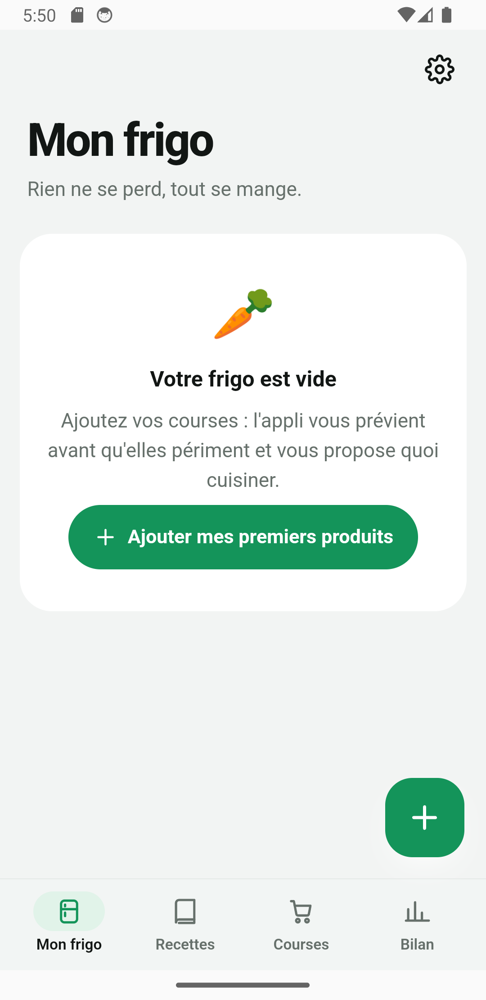
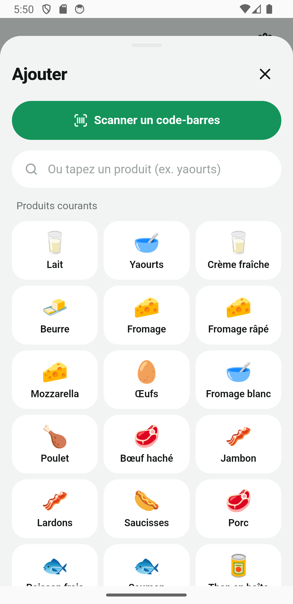
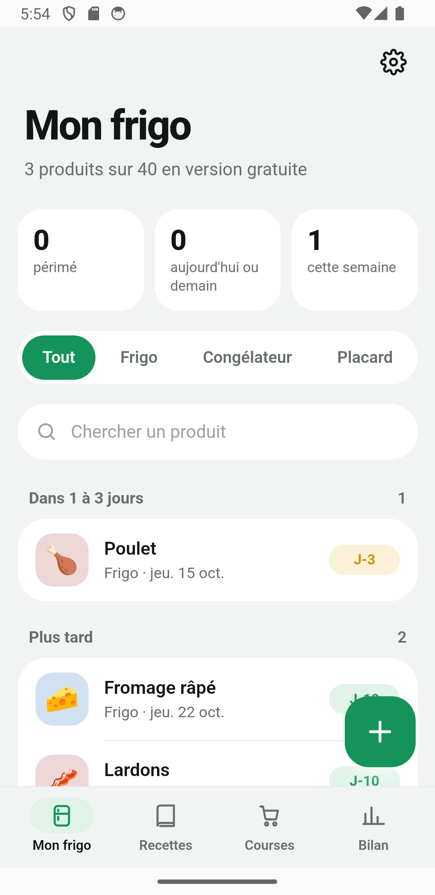

# Frigo anti-gaspi

Application Android qui prévient avant que les aliments ne périment et propose des recettes avec ce qui reste au frigo.

<p>
  
  
  
</p>

## Fonctionnalités

- **Scan de code-barres** (ML Kit) : le produit est retrouvé automatiquement, avec une durée de conservation proposée
- **Classement par urgence** (périmé, aujourd'hui, dans 3 jours, cette semaine) et rappel quotidien à l'heure choisie
- **40 recettes anti-gaspi** triées selon ce qui périme en premier ; « J'ai cuisiné ça » retire les produits utilisés
- **Allergènes et régimes** : 14 allergènes officiels, halal, casher, végétarien, végan… avec alertes au scan
- Données 100 % locales, sans compte ni publicité

## Stack

Vanilla JS + [Vite](https://vitejs.dev) · [Capacitor 8](https://capacitorjs.com) (Android) · notifications locales · tests avec `node --test`

## Développement

```bash
npm install
npm run dev            # http://127.0.0.1:5180
npm test               # 20 tests
npm run android:sync   # build web + synchronisation Android
npm run android:open   # ouvre Android Studio
```

Le guide de publication sur le Play Store se trouve dans [docs/PUBLIER.md](docs/PUBLIER.md).

## Méthode de travail

L'application a été conçue et développée avec **Claude Code** : spécification, logique métier testée, intégration native Capacitor (scan, notifications), puis préparation de la fiche Play Store.
